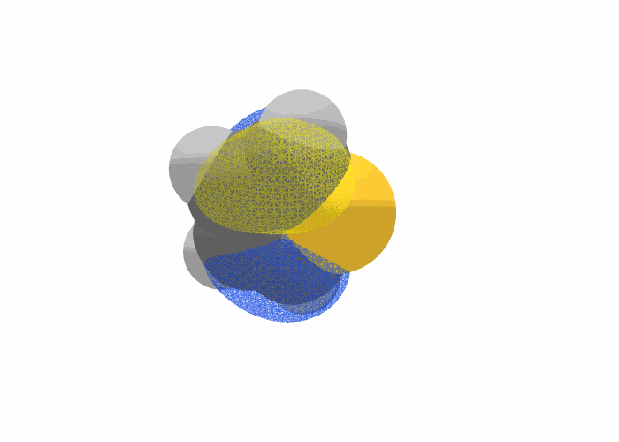

# ocal: Program for the calculation of orbital tail fraction (OTF) and participation ratio per molecular volume (PR/V) for organic semiconductor molecules
[](https://www.python.org)
[](https://opensource.org/licenses/MIT)
[](https://pypi.org/project/yu-ocal/)
[](https://matsui-lab-yamagata-univ.github.io/ocal/)

English / [日本語](https://github.com/matsui-lab-yamagata-univ/ocal/blob/main/README_ja.md)

# Overview
`ocal` is a tool for calculating the orbital tail fraction (OTF) and the participation ratio per molecular volume (PR/V) of a single organic semiconductor molecule. Starting from a molecular or crystal structure file, it generates a Gaussian input, runs a geometry optimization, converts the checkpoint file, and generates molecular-orbital cube files for the four frontier orbitals (NHOMO, HOMO, LUMO, NLUMO). It then computes the OTF and the PR/V for each orbital.

The OTF quantifies how much of a frontier orbital spills out of the molecular van der Waals volume, i.e. how much of it is available for intermolecular overlap. `PR` has the dimension of volume and expresses the volume the orbital effectively occupies, so the dimensionless `PR/V` quantifies how far the orbital is delocalized relative to the size of the molecule itself.

<p align="center">
  
</p>

## Definitions
The OTF is the integral of the squared absolute value of the wavefunction over the region **outside** the van der Waals radii of the atoms:

```math
\mathrm{OTF} = \int_{\mathbf{r} \notin V_\mathrm{vdW}} |\psi(\mathbf{r})|^2 \, d\mathbf{r}
```

The participation ratio `PR` (in ų) and the PR/V are defined as

```math
\mathrm{PR} = \frac{\left(\int |\psi(\mathbf{r})|^2 \, d\mathbf{r}\right)^2}{\int |\psi(\mathbf{r})|^4 \, d\mathbf{r}},
\qquad
\mathrm{PR/V} = \frac{\mathrm{PR}}{V}
```

where

- `ψ` is the normalized molecular orbital,
- `V_vdW` is the union of the van der Waals spheres of all atoms (a point lies outside it when its distance to every atom exceeds that atom's van der Waals radius), and
- `V` is the volume of `V_vdW`.

# Requirements
* Python 3.11 or newer
* NumPy 2.0.2 or newer
* Pandas 2.3.3 or newer

## Quantum Chemistry Calculation Tools
The following is required:
* Gaussian 16 (the `g16`, `formchk`, and `cubegen` executables must be on `$PATH`)

# Important notice
* The path of the Gaussian executable must be set. `ocal` invokes `g16`, `formchk`, and `cubegen` as subprocesses.
* The molecule is always treated as a **neutral closed-shell singlet**. Charge and spin multiplicity are fixed to `0 1`; any charge/spin information contained in the input file is ignored.
* The functional and basis set are fixed to **B3LYP/6-31G(d,p)** so that OTF and PR/V values remain comparable with previously published results. This is not exposed as a command-line option.
* For the same reason, the molecular volume `V` in PR/V is always integrated on a cubic grid with a fixed spacing of **0.2 Å**. This is not exposed as a command-line option either.
* Structure-file inputs are always geometry-optimized with `Opt=Tight` before the cube files are generated.

# Installation
`ocal` is distributed on PyPI under the name **`yu-ocal`** (the import name and the command name are both `ocal`).

```bash
pip install yu-ocal
```

NumPy and Pandas are installed automatically. Gaussian 16 is **not** included and must be installed separately.

## Verify Installation

After installation, you can verify by running:

```bash
ocal --help
```

# ocal Usage Manual

## Basic Usage

```bash
ocal <filename> [options]
```

### Required Arguments

- `file`: Path to the input file.

`ocal` accepts three classes of input and enters the pipeline at the corresponding stage:

| Input | Extensions | Pipeline stages executed |
|-------|------------|--------------------------|
| Structure file | `.gjf`, `.com`, `.xyz`, `.mol`, `.mol2`, `.cif` | gjf generation → Gaussian (Opt=Tight) → formchk → cubegen → OTF, PR/V |
| Formatted checkpoint | `.fchk` | cubegen → OTF, PR/V |
| Cube file | `.cube` | OTF, PR/V only |

For `.fchk` and `.cube` input, `-s, --skip-gaussian` is **required**; conversely it is rejected for structure-file input.

> **Note:** A `.cube` input must be a Gaussian `cubegen` MO cube with a Bohr-unit (positive voxel counts), orthogonal grid. Å-unit grids, non-orthogonal grids, and cubes whose number of voxel values does not match the header are rejected, and neither OTF nor PR/V is computed.

> **Note:** For a `.cif` input, only the **first unique molecule** (index 0) is used. If the cell contains more than one unique molecule (`Z' > 1`), a message is printed to that effect.

### Basic Examples

```bash
# Full run from a molecular structure
ocal xxx.xyz

# Start from an existing Gaussian formatted checkpoint file
ocal xxx.fchk -s

# Compute OTF and PR/V for a single cube file that already exists
ocal xxx_HOMO.cube -s
```

## Options

### Calculation Settings

#### `-c, --cpu <number>`
Specify the number of CPUs used by Gaussian and `cubegen`.
- **Default**: `4`
- **Example**: `ocal xxx.xyz -c 8`

#### `-m, --mem <memory>`
Specify the amount of memory in GB used by Gaussian.
- **Default**: `10`
- **Example**: `ocal xxx.xyz -m 16`

### Calculation Control

#### `-s, --skip-gaussian`
Skip the Gaussian calculation and reuse existing results. Required when the input is `.fchk` or `.cube`, and invalid for any other input type.
- **Default**: off
- **Example**: `ocal xxx.fchk -s`

## Practical Usage Examples

### Basic Calculations
```bash
# Default run (Gaussian 16, B3LYP/6-31G(d,p), Opt=Tight)
ocal xxx.xyz

# Use 8 CPUs and 16 GB memory
ocal xxx.mol -c 8 -m 16

# Take the first unique molecule out of a crystal structure
ocal xxx.cif
```

### Reusing Results
```bash
# Re-generate the cube files from an existing fchk and recompute OTF and PR/V
ocal xxx.fchk -s

# Recompute OTF and PR/V from a single existing cube file
ocal xxx_LUMO.cube -s
```

## Output

### Standard Output
`ocal` prints the input file name, timestamps, and every external command it runs, followed by a table of results:

```
-----------------------------------------------------------------------------------
 orbital               OTF           PR/V       PR(ų)        V(ų)    density_sum
-----------------------------------------------------------------------------------
 NHOMO        0.0259225568   0.1807090746    49.297436   272.800000   1.0000218010
 HOMO         0.0240639347   0.1545847566    42.170722   272.800000   0.9999913246
 LUMO         0.0273449721   0.1708050014    46.595604   272.800000   0.9999917497
 NLUMO        0.0276865261   0.1736069229    47.359969   272.800000   1.0000249449
-----------------------------------------------------------------------------------
```

- **`OTF`**: the orbital tail fraction, i.e. the sum of the normalized probability density over voxels whose distance to the nearest atom exceeds that atom's van der Waals radius.
- **`PR/V`**: the participation ratio divided by the molecular volume (dimensionless).
- **`PR(ų)`**: the participation ratio itself, i.e. the volume the orbital effectively occupies.
- **`V(ų)`**: the union volume of the van der Waals spheres of all atoms, integrated on a cubic grid with a fixed spacing of 0.2 Å. In the four-orbital run the volume computed for the first orbital is reused for the remaining three, since they describe the same molecule.
- **`density_sum`**: the total normalized density integrated over the whole cube grid. It should be close to `1.0`; a value far from unity indicates that the cube grid is too small or too coarse to contain the orbital, and the OTF and PR/V from that cube should not be trusted.

When the input is a single `.cube` file, the row is labelled with the cube file stem instead of an orbital name.

### Generated Files
All generated files are written next to the input file, sharing its base name:

```
<input dir>/
├── <NAME>.gjf          # Generated Gaussian input (Opt=Tight, B3LYP/6-31G(d,p))
├── <NAME>.log          # Gaussian output (.out on the Windows build)
├── <NAME>.chk          # Gaussian checkpoint file
├── <NAME>.fchk         # Formatted checkpoint file (formchk)
├── <NAME>_NHOMO.cube   # Molecular-orbital cube files (cubegen)
├── <NAME>_HOMO.cube
├── <NAME>_LUMO.cube
└── <NAME>_NLUMO.cube
```

#### Output file naming
For `.gjf` / `.com` input, the base name becomes `<NAME>_ocal` so that the input file is never overwritten. The cube files are named after the base name with the orbital appended: `<NAME>_NHOMO`, `<NAME>_HOMO`, `<NAME>_LUMO`, `<NAME>_NLUMO`.

The MO indices passed to `cubegen` are derived from the number of alpha electrons `na` in the fchk: NHOMO = `na-1`, HOMO = `na`, LUMO = `na+1`, NLUMO = `na+2`.

## Notes

1. **Calculation Time**: Almost all of the runtime is the Gaussian geometry optimization; it grows quickly with the number of atoms.
2. **Memory Usage**: Ensure sufficient memory for large molecules (`-m`).
3. **Gaussian Installation**: Gaussian 16 is required. `formchk` and `cubegen` ship with Gaussian and must also be callable.
4. **Cube Grid**: The cube files are generated with `cubegen`'s `-2` (fine) grid and header option `h`. Always check `density_sum` before using an OTF or PR/V value.
5. **Molecular Volume**: `V` is a grid approximation of the union of hard van der Waals spheres; the grid spacing is fixed to 0.2 Å so that PR/V values are always obtained under the same discretization.

## Troubleshooting

### `Failed to execute g16 / formchk / cubegen` / `Gaussian did not terminate normally`
The executable was not found, or the Gaussian calculation did not terminate normally.

- **Executable not found**: Make sure the Gaussian environment is loaded (e.g. by sourcing the Gaussian profile script) so that `g16`, `formchk`, and `cubegen` are on `$PATH`.
- **Gaussian did not terminate normally**: For `g16`, this is typically an SCF convergence or geometry optimization failure. Check the `.log` (`.out` on Windows) file in the working directory, fix the underlying problem, and re-run. For `.gjf` / `.com` input, the log file is named `xxx_ocal.log`.

### `Å-unit cube grids ... are not supported` / `non-orthogonal grid vectors` / `expected N voxel values, got M`
The cube file is not a supported Gaussian `cubegen` MO cube, or it is truncated. Re-generate it with `cubegen` (e.g. by running `ocal xxx.fchk -s`).

### If a structure file cannot be read
Structure files come in various formats, and some may not be readable by ocal. Please try the following:

1. **Convert the format using another software**: Use software such as [Mercury](https://www.ccdc.cam.ac.uk/solutions/software/mercury/) or Open Babel to re-export the file, which may resolve the issue.
2. **Contact us**: If you send the unreadable file to us by email, we will work on adding support for it. Please contact us at the email address listed below.

> **Note:** For `.gjf` / `.com` input only the plain `symbol x y z` Cartesian format is supported. Atomic numbers instead of symbols, freeze flags, Z-matrices, and ONIOM layers are rejected.

# Authors
[Matsui Laboratory, Research Center for Organic Electronics (ROEL), Yamagata University](https://matsui-lab.yz.yamagata-u.ac.jp/index-e.html)  
Tomoharu Okada, Koki Ozawa, Hiroyuki Matsui  
Email: h-matsui[at]yz.yamagata-u.ac.jp  
Please replace [at] with @
